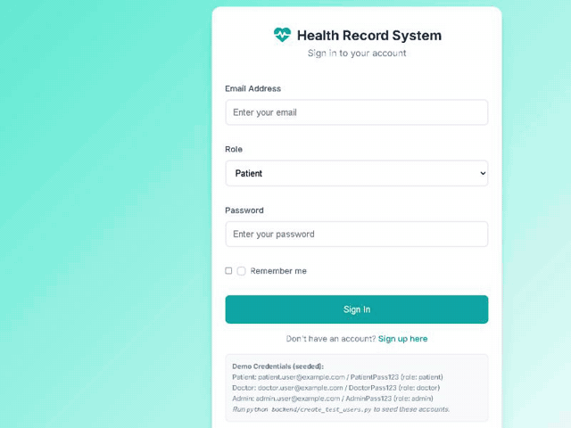
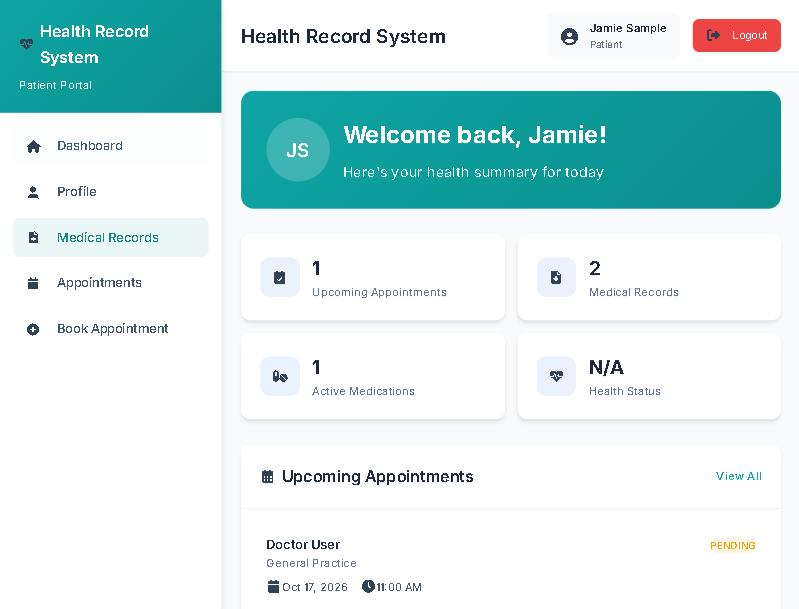
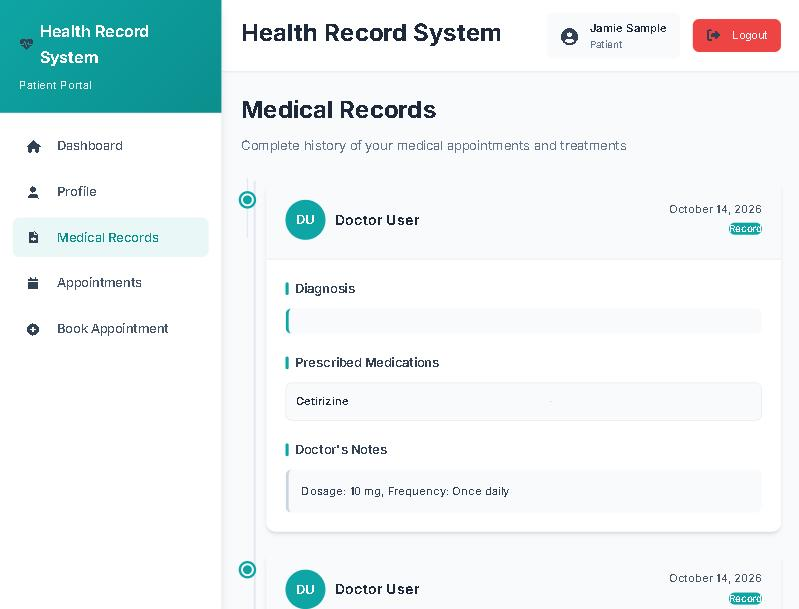
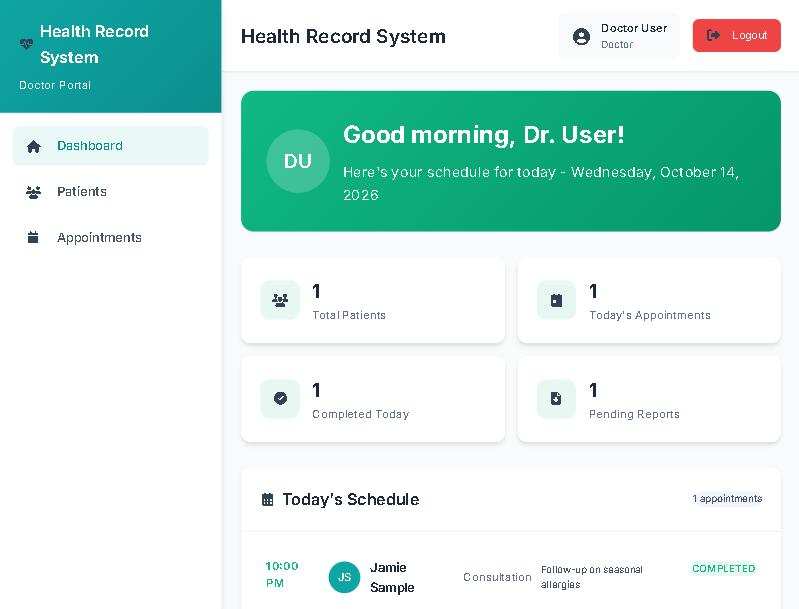
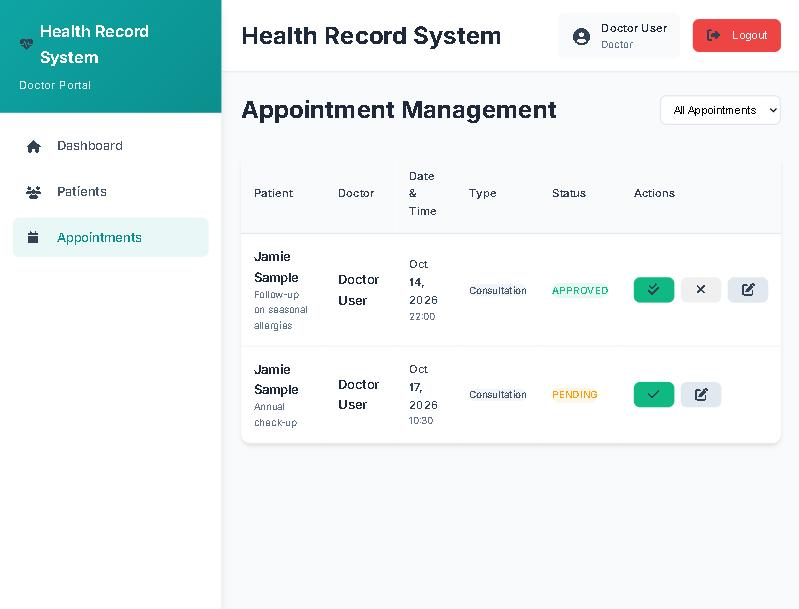
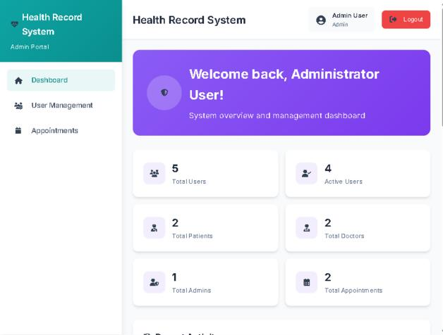
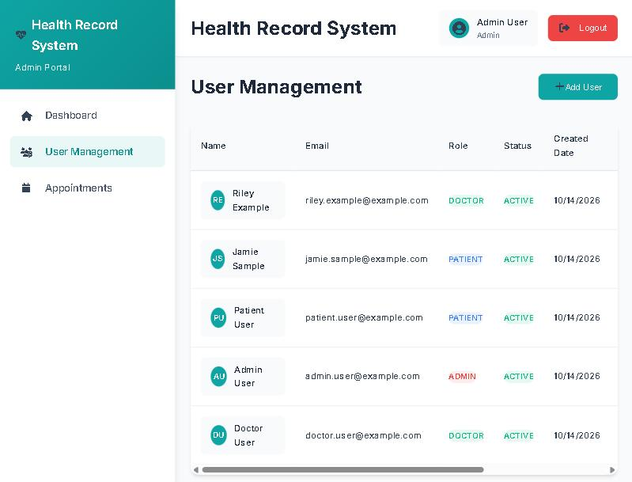
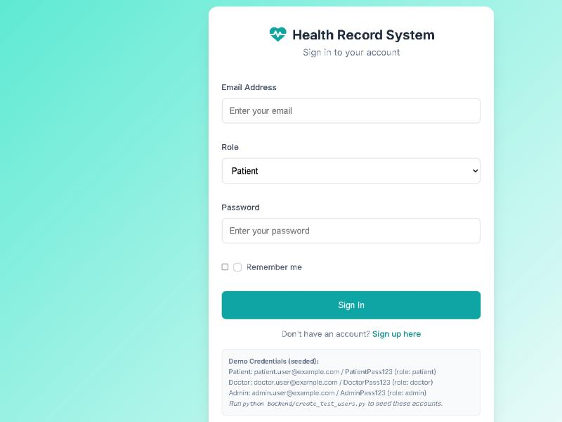
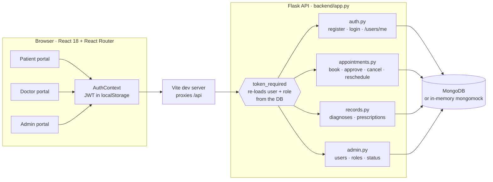
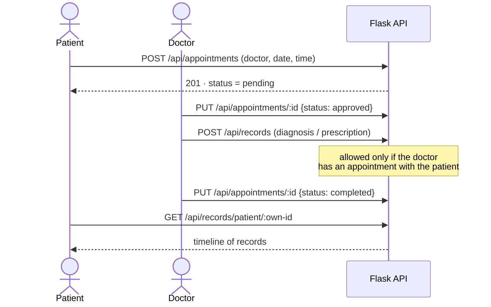

<p align="center"></p>

<p align="center">
  
  
  
  
  
  
  
</p>

<p align="center">
  
</p>

## What it is

**Health Record System** is a full-stack prototype for a small clinic. **Patients** book appointments and read their medical history, **doctors** run their schedule and write diagnoses and prescriptions, and **administrators** manage accounts. One React app serves all three roles. Each role has its own portal and routes, and a Flask + MongoDB API enforces the same permissions on the server.

> ⚠️ This is a learning/demo prototype. It is not certified for real patient data (HIPAA/GDPR etc.). Use fictional data only.

<p align="center"></p>

## Features

| | Feature | Who | Details |
|---|---|---|---|
| 🔐 | Sign-in & registration | Everyone | JWT sessions, bcrypt-hashed passwords. Public sign-up always creates a patient account. |
| 🏠 | Patient dashboard | Patient | Upcoming appointments, record count, prescriptions on file, quick actions |
| 📅 | Book appointments | Patient | Pick a doctor, date, time and notes. Double-booking and past times are rejected. |
| 🗂️ | My appointments | Patient | Upcoming / Pending / Completed / Cancelled tabs; cancel pending or approved visits |
| 📋 | Medical records timeline | Patient | Diagnoses, prescriptions and doctor's notes, newest first |
| 👤 | Profile | Patient | Personal details, blood type, allergies, emergency contact (editable) |
| 🩺 | Doctor dashboard | Doctor | Today's schedule, patient and appointment stats, recent patients |
| 👥 | Patient list | Doctor | Search patients you have appointments with; open their chart |
| 💊 | Diagnoses & prescriptions | Doctor | Add a diagnosis or a prescription (medication, dosage, frequency) to a patient's chart |
| ✅ | Appointment workflow | Doctor | Approve → complete, or cancel; reschedule date/time |
| 📊 | Admin dashboard | Admin | User/role/appointment counts and recent activity |
| 🛠️ | User management | Admin | Create, edit, activate/deactivate and delete users; assign roles |
| 🛡️ | Access control | All | Role-guarded routes in the UI *and* server-side checks: patients only see their own data, and doctors only see patients they treat |

## Screenshots

All data shown is fictional demo data.

| Patient dashboard | Medical records |
|---|---|
|  |  |
| **Doctor dashboard** | **Appointment management** |
|  |  |
| **Admin dashboard** | **User management** |
|  |  |

<details>
<summary>Sign-in screen</summary>


</details>

## Architecture





## Quickstart

**Prerequisites:** Node.js 20.19+ (required by Vite 7), Python 3.10+. MongoDB is optional (see the in-memory mode below).

```bash
# 1. Frontend dependencies
npm install

# 2. Backend dependencies
cd backend
python -m venv .venv
source .venv/bin/activate          # Windows: .\.venv\Scripts\Activate.ps1
pip install -r requirements.txt
cp .env.example .env               # then edit values (see table below)
```

**Run without installing MongoDB:** the in-memory database starts empty and seeds the demo accounts automatically.

```bash
# terminal 1 — API on http://localhost:5000
cd backend
MONGO_URI=mongomock:// python app.py          # PowerShell: $env:MONGO_URI="mongomock://"; python app.py

# terminal 2 — web app on http://localhost:3000 (proxies /api to :5000)
npm run dev
```

**With a real MongoDB:** set `MONGO_URI` in `backend/.env`, run `python create_test_users.py` once to add the demo accounts, then `python app.py`.

**Demo accounts** (pick the matching role on the sign-in screen):

| Role | Email | Password |
|---|---|---|
| Patient | `patient.user@example.com` | `PatientPass123` |
| Doctor | `doctor.user@example.com` | `DoctorPass123` |
| Admin | `admin.user@example.com` | `AdminPass123` |

Other scripts: `npm run build` (production build into `dist/`) and `npm run preview`.

## Configuration

Backend settings live in `backend/.env` (template: [`backend/.env.example`](backend/.env.example)). **No third-party API keys are needed.**

| Variable | Required? | Default | Where to get it / notes |
|---|---|---|---|
| `JWT_SECRET` | **Yes, for any shared or real use** | random per run | Generate it yourself: `python -c "import secrets; print(secrets.token_urlsafe(48))"`. If unset, a random secret is used and everyone is signed out on restart. |
| `MONGO_URI` | Optional | `mongodb://localhost:27017/` | Your MongoDB connection string (local install, Docker `mongo` image, or MongoDB Atlas → *Connect*). Use `mongomock://` for the in-memory demo database. |
| `DB_NAME` | Optional | `health_record_system` | Any database name |
| `JWT_EXP_HOURS` | Optional | `1` | Session lifetime in hours |
| `CORS_ORIGINS` | Optional | `http://localhost:3000` | Comma-separated origins allowed to call the API directly |
| `PORT` | Optional | `5000` | API port |
| `API_PROXY_TARGET` | Optional (frontend shell env) | `http://localhost:5000` | Where the Vite dev server forwards `/api` |

<details>
<summary><b>Project structure</b></summary>

```text
Health-Record-System/
├── index.html                 # Vite entry HTML
├── vite.config.js             # dev server on :3000, /api proxy
├── src/
│   ├── main.jsx, App.jsx      # router + role-protected routes
│   ├── index.css              # shared styles
│   ├── contexts/AuthContext.jsx
│   ├── components/            # Layout, Header, Sidebar, Toast
│   ├── utils/toast.js
│   └── pages/
│       ├── auth/              # Login, Register
│       ├── patient/           # Dashboard, Profile, MedicalRecords, Appointments
│       ├── doctor/            # Dashboard, PatientList, PatientMedicalRecordView, PrescriptionForm
│       ├── admin/             # AdminDashboard, UserManagement
│       ├── appointments/      # AppointmentList, BookAppointment
│       └── Unauthorized.jsx
├── backend/
│   ├── app.py                 # Flask app, blueprints, security headers
│   ├── config.py              # env config, MongoDB / mongomock client
│   ├── auth.py                # register, login, token_required, /users/me
│   ├── appointments.py        # appointment CRUD + status rules
│   ├── records.py             # medical records
│   ├── admin.py               # user management, user lookup
│   ├── create_test_users.py   # demo account seeding
│   ├── requirements.txt
│   └── .env.example
└── docs/readme/               # README banner, screenshots, walkthrough
```
</details>

### API overview

| Method & path | Who | Purpose |
|---|---|---|
| `POST /api/auth/register` | public | Create a patient account |
| `POST /api/auth/login` | public | Get a JWT |
| `GET` / `PUT /api/users/me` | signed in | Read / update own profile |
| `GET /api/users?role=doctor` | signed in | List bookable doctors |
| `GET /api/users/:id` | signed in | Own record, a doctor's public card, or (doctor) a patient they treat |
| `GET` / `POST /api/users`, `PUT` / `DELETE /api/users/:id` | admin | User management |
| `GET` / `POST /api/appointments` | signed in / patient | List own appointments / book one |
| `PUT /api/appointments/:id` | owner | Patient cancels; doctor approves/completes/cancels/reschedules; admin reschedules |
| `POST /api/records` | doctor | Add diagnosis or prescription for a patient under their care |
| `GET /api/records/patient/:id` | patient (self) / treating doctor | Medical history |
| `GET /api/health` | public | Liveness check |

## What's new in this version

| Area | Before | After |
|---|---|---|
| Sign-up | Anyone could register as **admin** or doctor | Public sign-up always creates a patient; staff accounts are created by an admin |
| Database access | Unauthenticated `/api/db-test` could read and write the DB | Endpoint removed |
| Login tokens | Publicly known default secret `change-me-in-prod`; role trusted from the token; deleted or deactivated users kept access | Secret from env (random if unset); every request re-loads the user and role from the DB; inactive users are blocked |
| Medical records | Any doctor could write into any patient's chart | Only doctors with an appointment with that patient |
| Input handling | Non-string JSON such as `{"$ne": ""}` reached queries or crashed with a 500 | Rejected with 400; statuses and roles are validated |
| Profile | "Save" did nothing (endpoint missing); sign-up details were discarded | `PUT /api/users/me` added; sign-up details are stored |
| Doctor pages | Dashboard crashed; adding a diagnosis crashed the chart; patient IDs were `undefined` | All render and update correctly |
| Appointments | Doctor names showed as IDs; seeded doctor not bookable; dates shifted to the UTC day; edit form couldn't save; "completed" was unreachable | Names shown; booking works; local dates; reschedule works; doctors can mark visits completed |
| Layout & links | Top bar hidden under the sidebar; links to non-existent pages; `alert()` placeholder buttons; fake "Email/Backup" status | Fixed layout; dead links and placeholders removed |
| Local setup | Required a running MongoDB | `MONGO_URI=mongomock://` runs fully in memory with demo users |

## Future development

These are ideas, not current features:

- Move the token from `localStorage` to an HttpOnly cookie, and add rate limiting on login
- Patient-side rescheduling (today patients cancel and re-book)
- A data source for the "Health Status" dashboard card (it currently shows `N/A`)
- Document uploads (lab results, scans) and notifications
- Automated tests (backend pytest suite, frontend component tests)

## Security notes

- Use fictional data only. This prototype has no audit log, encryption at rest or compliance controls.
- Always set a strong `JWT_SECRET` and serve over HTTPS outside local development.
- API responses send `Cache-Control: no-store` so health data isn't cached by browsers.
